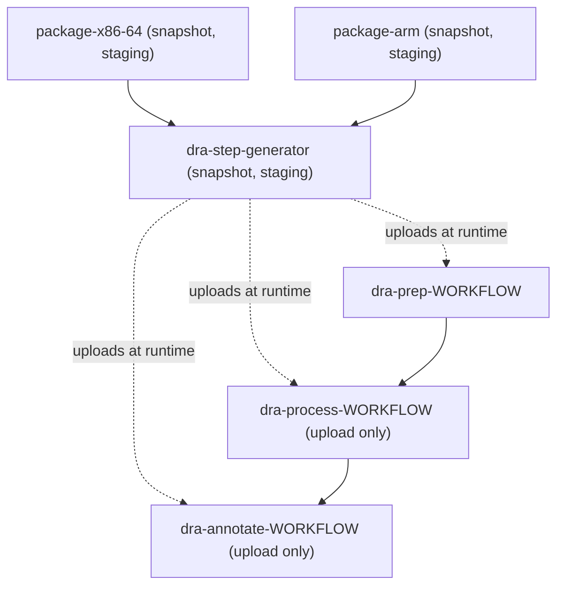

# apm-server-package (Buildkite)

Builds the APM Server distribution packages for the snapshot and staging channels on x86-64 and aarch64, then generates the Unified Release (DRA) steps that stage and publish them.

## At a glance

| | |
| --- | --- |
| Platform | Buildkite |
| Source | [`.buildkite/package.yml`](../package.yml) |
| Trigger | Commit builds (`build_on_commit`) and pull request comments matching `^/package` (`build_on_comment`), configured in [`pull-requests.json`](../pull-requests.json) |
| Pipeline slug | `apm-server-package` |
| Hooks | [`pre-command`](../hooks/pre-command), [`pre-exit`](../hooks/pre-exit) |

## Purpose

Produces the APM Server distributions (tarballs, RPMs and other packages, Docker image tarballs, and dependency CSVs) for both the snapshot and staging channels, and generates the DRA sub-pipeline that stages them for the Unified Release process. The package steps run on x86-64 and aarch64 builders.

## When it runs

| Trigger | Behavior |
|---------|----------|
| Commit build (`build_on_commit: true`) | Builds run for commits, unless a skip rule below applies. Whether this is limited to pull request branches is controlled by Buildkite settings outside this repository (source gap). |
| Pull request comment (`build_on_comment: true`) | A comment matching `^/package` starts a build. |
| Skip label `skip-ci` | Commit builds are skipped when the pull request has this label. |
| Changed files | Commit builds are skipped when changes fall only in the paths listed in `skip_ci_on_only_changed` (below). |
| Target branches | `skip_target_branches` is empty; no target branch is skipped. |

### Comment regex behavior

Both `trigger_comment_regex` and `always_trigger_comment_regex` are `^/package`.

- Matches: a comment whose first characters are `/package`, for example `/package`, `/package snapshot`, or `/packages`, because the pattern has no end anchor.
- Does not match: a comment with text or whitespace before `/package` (for example `please /package`), or a different case such as `/Package`, because the pattern has no case-insensitive flag.
- Both settings have the same value, so this repository does not distinguish between them. The effect of `always_trigger_comment_regex` on skip rules is Buildkite-side behavior and is a source gap.

### Skipped changed-file patterns

`skip_ci_on_only_changed` contains these patterns, matched against changed file paths:

- `^.ci/`, `^.github/`, `catalog-info.yaml`, `^updatecli-compose.yaml`, `^changelog`, `^docs/`
- `\.md$`, `^docker-compose.yml`, `^.mergify.yml`, `^.pre-commit-config.yaml`, `\.txt$`, `Tiltfile`

The dot in patterns such as `^.ci/` is unescaped, so it matches any character. `Tiltfile` is not anchored and matches anywhere in a path. The exact rule that decides when a commit is skipped (for example, all changed files versus any changed file) is a Buildkite setting and is a source gap.

### Trigger access

- `allow_org_users`: `true`.
- `allowed_repo_permissions`: `admin` and `write`.
- `allowed_list`: `dependabot[bot]`, `elastic-observability-automation[bot]`, `github-actions[bot]`, `mergify[bot]`.
- `set_commit_status`: `true`.
- Fork pull request handling is not specified in the repository (source gap).

## Execution flow

| Job or step | Runs when | Depends on | What it does |
| --- | --- | --- | --- |
| `package-x86-64` (`Package x86_64`) | Each matrix value: `snapshot`, `staging` | None declared | Runs [`package.sh`](../scripts/package.sh) on GCP `c4d-standard-16` (`hyperdisk-balanced` disk) with Ubuntu 24.04 (`family/core-ubuntu-2404`). Uploads `build/distributions/**/*` and `build/dependencies*.csv`. Timeout 120 minutes. |
| `package-arm` (`Package aarch64`) | Each matrix value: `snapshot`, `staging` | None declared | Runs `package.sh` on AWS `c8g.2xlarge` with the `core-ubuntu-2404-aarch64` image prefix. Uploads `build/distributions/**/*` only. Timeout 120 minutes. |
| `dra-step-generator` (`:pipeline: Generate DRA steps`) | Each matrix value: `snapshot`, `staging` | `package` group, `allow_failure: false` | Runs [`dra.sh`](../scripts/dra.sh) on GCP `c4d-standard-16` (`hyperdisk-balanced` disk), which uploads the DRA sub-pipeline. Timeout 10 minutes. |
| `dra-prep-WORKFLOW` | Uploaded by `dra.sh` | `None declared` | Runs [`stage-dra-artifacts.sh`](../scripts/stage-dra-artifacts.sh) and the `elastic/dra-prep` plugin. Timeout 30 minutes. |
| `dra-process-WORKFLOW` | Uploaded only when `DRA_UPLOAD` is `true` | `dra-prep-WORKFLOW` | Triggers the `unified-release-dra-processing` pipeline. |
| `dra-annotate-WORKFLOW` | Uploaded only when `DRA_UPLOAD` is `true` | `dra-process-WORKFLOW` | Runs [`dra-annotate.sh`](../scripts/dra-annotate.sh). Timeout 5 minutes. |

`WORKFLOW` is the matrix value, `snapshot` or `staging`.

### Package script

[`package.sh`](../scripts/package.sh) takes `snapshot` or `staging` as its argument.

- On `aarch64` builders, it runs `package-docker` (or `package-docker-snapshot`). On other builders, it runs `package` (or `package-snapshot`). These targets are in [`Makefile`](../../Makefile) and [`packaging.mk`](../../packaging.mk).
- For `staging`, it loads [`utils.sh`](../scripts/utils.sh), sets `VERSION` and `DRA_BRANCH`, fetches the Elastic qualifier for `DRA_BRANCH`, and exports it as `ELASTIC_QUALIFIER`. The Makefile uses this qualifier in the version metadata.
- `package` also builds the Docker image tarballs, the IronBank Docker build context, and `build/dependencies-VERSION.csv`. `GENERATE_WOLFI_IMAGES` and `GENERATE_FIPS_ARTIFACTS` add Wolfi and FIPS artifacts. The pipeline sets both to `true`.

### DRA generator

[`dra.sh`](../scripts/dra.sh) takes `snapshot` or `staging` as its argument. It uploads the steps in the table above with `buildkite-agent pipeline upload`.

- It sets `DRA_UPLOAD` to `false` (dry run) when the build is a pull request, or when `BUILDKITE_BRANCH` does not appear as a quoted string in the `active-branches.json` file downloaded from the snapshot branches endpoint. Otherwise it sets `DRA_UPLOAD` to `true`.
- With `DRA_UPLOAD` set to `false`, the `elastic/dra-prep` plugin runs with `upload: false`, and the process and annotate steps are not uploaded.
- For `staging`, it reads the qualifier for `DRA_BRANCH` and generates the sub-pipeline only when `DRA_BRANCH` is not `8.x`. The stack version is `VERSION-QUALIFIER` when a qualifier exists.
- For `snapshot`, it always generates the sub-pipeline with no qualifier, and the stack version is `VERSION`.

## Inputs, outputs, and access

| Item | Details |
| --- | --- |
| Inputs | Matrix values `snapshot` and `staging`. Pipeline environment: `IMAGE_UBUNTU_X86_64`, `IMAGE_UBUNTU_ARM_64`, `GENERATE_WOLFI_IMAGES`, `GENERATE_FIPS_ARTIFACTS`. Buildkite variables such as `BUILDKITE_BRANCH`, `BUILDKITE_PULL_REQUEST`, and `BUILDKITE_PULL_REQUEST_BASE_BRANCH`. |
| Outputs | Package artifacts: `build/distributions/**/*` and `build/dependencies*.csv` (x86-64 only). DRA manifests as `artifacts/dra/apm-server/*/manifest-*.json`. When uploading, a Buildkite annotation with the DRA summary link on `artifacts-WORKFLOW.elastic.co`. |
| Permissions | Trigger access is set in `pull-requests.json` (see above). The pipeline does not declare GitHub token permissions. |
| Trigger access | `allow_org_users: true`; `allowed_repo_permissions`: `admin`, `write`; `allowed_list`: four bot accounts. |
| Secrets | Hook-loaded secrets are listed in [Secrets](#secrets) below. `VAULT_GITHUB_TOKEN` is read from the Buildkite environment. |

### Secrets

Names only. [`pre-command`](../hooks/pre-command) reads these Vault entries with the `vault` CLI, reading the `username`, `password`, and `registry` fields:

- `kv/ci-shared/observability-ci/docker-elastic-observability`
- `kv/ci-shared/observability-ci/docker-hub-observability`

It creates these environment variables: `DOCKER_USERNAME_SECRET` and `DOCKER_PASSWORD_SECRET` (unset after login), `DOCKER_REGISTRY_SECRET` (exported), `DOCKERHUB_REGISTRY_SECRET`, and `GH_TOKEN` (set from `VAULT_GITHUB_TOKEN`). The `_SECRET` and `_TOKEN` suffixes let Buildkite mask these values.

## Operational notes

- **Hooks:** `pre-command` skips when the command contains `upload`. Otherwise it logs in to the two Docker registries when `docker` is available, sets up `GH_TOKEN`, downloads the `gvm` v0.6.0 binary from GitHub releases, and selects the Go version from `go.mod`. `pre-exit` runs `docker logout` for the two registry variables when `docker` is available.
- **Retries:** both package steps have one automatic retry. The retry declares no `exit_status`, so the default Buildkite retry matching applies (source gap for the exact behavior).
- **Failure handling:** the DRA generator depends on the whole `package` group with `allow_failure: false`, so it does not run when a package job fails.
- **Dry runs:** pull request builds and branches outside the active list run the DRA steps with `upload: false`. They do not trigger processing or annotate a summary.
- **Notifications:** the `notify` block posts to `#apm-server` and `#observablt-bots` when a build fails on `main`, a `MAJOR.MINOR` branch, or a `MAJOR.x` branch.
- **Dynamic uploads:** `dra.sh` uploads the DRA sub-pipeline described above. No other step uploads steps.

## Sources

- Pipeline: [`.buildkite/package.yml`](../package.yml)
- Pull request integration settings: [`.buildkite/pull-requests.json`](../pull-requests.json)
- Hooks: [`pre-command`](../hooks/pre-command), [`pre-exit`](../hooks/pre-exit)
- Scripts: [`package.sh`](../scripts/package.sh), [`dra.sh`](../scripts/dra.sh), [`stage-dra-artifacts.sh`](../scripts/stage-dra-artifacts.sh), [`dra-annotate.sh`](../scripts/dra-annotate.sh), [`utils.sh`](../scripts/utils.sh)
- Build targets: [`Makefile`](../../Makefile), [`packaging.mk`](../../packaging.mk)

### Source gaps

- `elastic/dra-prep#v0.1.7`, `elastic/gh-cli`, and the `unified-release-dra-processing` pipeline are not in this repository.
- Buildkite pipeline settings (pipeline environment, branch filters for commit builds, fork pull request handling, skip-rule matching details, and the exact semantics of `always_trigger_comment_regex`) are outside this repository.
- The `gvm` binary and the Vault and Docker registry values are external. Their contents are not verified.
- The `package` make targets and the names of the dependency CSVs were not read in full.
- `dra_process_other_branches` uses `BRANCHES_URL`, which `dra.sh` defines but `package.sh` does not. Its use in the feature-branch annotation message is unverified.

