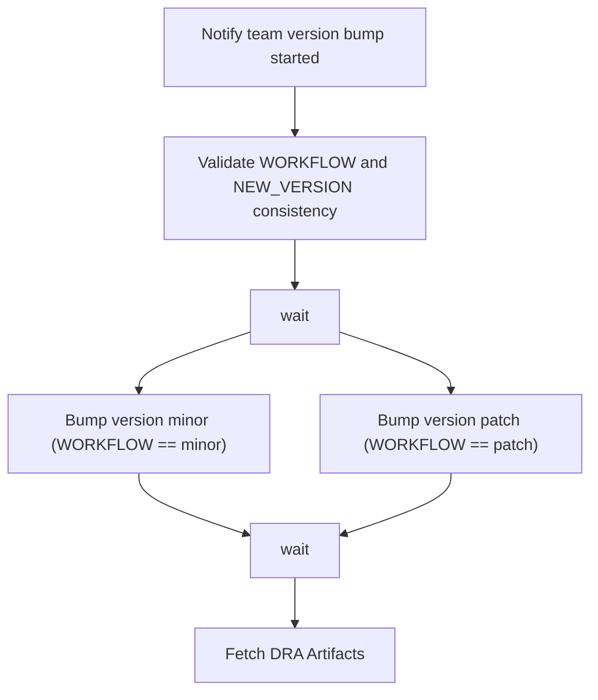

# version-bump-pipeline (Buildkite)

Bumps the APM Server version with a minor or patch release workflow, then fetches the resulting Unified Release (DRA) artifacts.

## At a glance

| | |
| --- | --- |
| Platform | Buildkite |
| Source | [`.buildkite/version-bump-pipeline.yml`](../version-bump-pipeline.yml) |
| Trigger | Not specified in the source. The pipeline reads the build environment variables `WORKFLOW` and `NEW_VERSION`, which the file does not define. |
| Hooks | [`pre-command`](../hooks/pre-command), [`pre-exit`](../hooks/pre-exit), which apply to every job in this repository |

## Purpose

Automates a version bump for APM Server. The pipeline validates that `WORKFLOW` and `NEW_VERSION` agree, dispatches the matching GitHub release workflow in this repository, and then runs the `version-bump-dra` plugin to fetch the DRA artifacts for the new version. The file contains no comment explaining the wider release process, so that process is not documented here.

## When it runs

The trigger is not specified in the source. The file has no pull request trigger configuration, and `pull-requests.json` has no entry for this pipeline.

Two Slack notifications depend on the branch name:

- A "started" notification runs when the branch is `main` or matches `^[0-9]+\.[0-9x]+\$`.
- A final notification runs for the same branches when the build state is `passed` or `failed`.

The branch pattern ends with `\$`. In a regular expression this matches a literal `$` at the end, not the end of the string. The package pipeline uses `$$` for the same position. Whether this matches the intended branches cannot be verified from the repository, so it is a source gap.

## Execution flow

| Job or step | Runs when | Depends on | What it does |
| --- | --- | --- | --- |
| `Notify team version bump started` | Branch is `main` or matches the branch pattern above | None declared | Runs `echo "Version bump started"` and sends a Slack message to `#apm-server` that names `NEW_VERSION` and links the build. |
| `Validate WORKFLOW and NEW_VERSION consistency` | Always, after the notification step | None declared | For `minor`, requires `NEW_VERSION` to end with `.0`. For `patch`, requires it not to end with `.0`. Any other `WORKFLOW` value fails. |
| `wait` | After validation | Validation step | Waits for the previous steps. The file does not declare `continue_on_failure`. |
| `Bump version minor` | `WORKFLOW` is `minor` | `wait` | Uses `elastic/vault-github-token#v0.1.0` and `elastic/gh-cli#v0.1.1` (version `2.88.1`, `wait: true`) to dispatch [`run-minor-release.yml`](../../.github/workflows/run-minor-release.yml) on `main`, with input `version` set to `NEW_VERSION`. |
| `Bump version patch` | `WORKFLOW` is `patch` | `wait` | Dispatches [`run-patch-release.yml`](../../.github/workflows/run-patch-release.yml) on `main` in the same way. |
| `wait` | After the bump steps | Bump steps | Waits for the bump steps. |
| `Fetch DRA Artifacts` (`fetch-dra-artifacts`) | Runs after the second `wait`, with no condition | Second `wait` | Uses `elastic/version-bump-dra#v1.0.0` with product `apm-server`, `version` set to `NEW_VERSION`, `workflow` set to `WORKFLOW`, and `polling_interval: 30`. Runs on the `wolfi-build-essential-release-eng` image with 250m CPU, 512Mi memory, and 1Gi ephemeral storage. Timeout 480 minutes. |

Because `Fetch DRA Artifacts` has no condition, it runs whenever the build reaches it, even if neither bump step ran. Buildkite's default behavior prevents later steps after a failed step, so a failed validation stops the build before the bump steps. This default is not declared in the file and is a source gap.

## Inputs, outputs, and access

| Item | Details |
| --- | --- |
| Inputs | Build environment variables `WORKFLOW` (`minor` or `patch`) and `NEW_VERSION`. The file does not define them. Their source is a source gap. |
| Outputs | A GitHub workflow dispatch for the release workflow. DRA artifacts fetched by the `version-bump-dra` plugin. Slack notifications. |
| Permissions | The bump steps use a GitHub token from the `elastic/vault-github-token` plugin. The plugin configuration is empty in the file, so the Vault paths and token scope are not documented here. |
| Trigger access | Not specified in the source. |
| Secrets | Not referenced by name in this file. The `vault-github-token` plugin provides the GitHub token (source gap for its name and path). |

## Operational notes

- **Retries:** `Fetch DRA Artifacts` retries automatically up to 2 times on any exit status. It can also be retried manually after the build has passed.
- **Timeouts:** `Fetch DRA Artifacts` has a 480-minute timeout. The other steps declare no timeout.
- **Hooks:** the repository hooks in [`.buildkite/hooks`](../hooks) run before each job in this repository. This includes the steps in this pipeline. The hooks download `gvm`, log in to Docker, and set `GH_TOKEN` from `VAULT_GITHUB_TOKEN`. Their details are in [apm-server-package](./apm-server-package.md#operational-notes).
- **Dynamic uploads:** none. The file has no `buildkite-agent pipeline upload` step.

## Sources

- Pipeline: [`.buildkite/version-bump-pipeline.yml`](../version-bump-pipeline.yml)
- Release workflows dispatched by the bump steps: [`run-minor-release.yml`](../../.github/workflows/run-minor-release.yml), [`run-patch-release.yml`](../../.github/workflows/run-patch-release.yml)
- Repository hooks: [`pre-command`](../hooks/pre-command), [`pre-exit`](../hooks/pre-exit)

### Source gaps

- `elastic/vault-github-token#v0.1.0`, `elastic/gh-cli#v0.1.1`, and `elastic/version-bump-dra#v1.0.0` are external plugins and are not in this repository.
- The source of `WORKFLOW` and `NEW_VERSION` is not in this repository. The Buildkite trigger, schedule, and pipeline settings are also outside it.
- `.ci/updatecli` is not referenced by this pipeline, so no updatecli values were used.
- The `unified-release-dra-processing` and `version-bump-dra` processing outcomes are external.
- The behavior of `wait` after a failed step and the branch pattern's `\$` escape are not verified.
