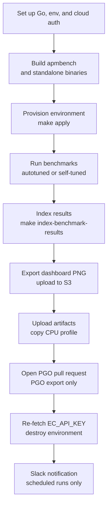

# Benchmarks

Runs apm-server benchmarks against a cloud or standalone environment provisioned with Terraform, indexes the results, publishes a dashboard snapshot, and optionally opens a pull request that updates the PGO profile.

## At a glance

| Field | Value |
|---|---|
| Definition | [`benchmarks.yml`](../benchmarks.yml) |
| Triggers | Manual (`workflow_dispatch`); runs on a weekly schedule and a monthly schedule |
| Path filter | None |
| Token permissions | Workflow: `contents: read`. Job: `contents: write`, `id-token: write` |
| Secrets | `GOBENCH_PASSWORD`, `GOBENCH_USERNAME`, `GOBENCH_HOST`, `ELASTIC_DOCKER_REGISTRY`, `ELASTIC_DOCKER_USERNAME`, `ELASTIC_DOCKER_PASSWORD`, `OBS_AUTOMATION_APP_ID`, `OBS_AUTOMATION_APP_PEM`, `GPG_PRIVATE_KEY`, `GPG_PASSPHRASE`, `KIBANA_BENCH_ENDPOINT`, `KIBANA_BENCH_USERNAME`, `KIBANA_BENCH_PASSWORD`, `KIBANA_BENCH_DASHBOARD`, `SLACK_BOT_TOKEN`, `EC_API_KEY` (read from Secret Manager, not a repository secret) |
| Runners | `ubuntu-latest` |

## Purpose

Measures apm-server performance using `apmbench` against a Terraform-provisioned environment. Each run indexes results into a benchmark Elasticsearch cluster, exports a Kibana dashboard image, and destroys the environment at the end. Monthly runs also collect a CPU profile and open a pull request that updates `default.pgo`.

## When it runs

- **Manually**, with the inputs listed below.
- **On a weekly schedule**: a regular run against a build from the commit. Scheduled runs skip the `BenchmarkTraces*` scenarios.
- **On a monthly schedule**: a PGO run that uses a standalone APM Server with Moxy, exports a CPU profile, and opens the PGO pull request.

Scheduled failures and successes are posted to Slack.

## Execution flow

The job is a single sequential job, `benchmarks`. Steps marked `always()` run after failures, and the teardown runs even when earlier steps fail.

| Job | Runs when | Depends on | What it does |
|---|---|---|---|
| `benchmarks` | Manual or scheduled | None | Runs all steps in the flow above, in the `testing/benchmark` working directory. |

### Key steps

| Step | Details |
|---|---|
| Set up env | Sets `TF_VAR_BRANCH`, `TF_VAR_CREATED_AT`, and `USER`. Sets `BENCHMARK_WARMUP_TIME`: `10m` for scheduled regular runs, `3m` for scheduled standalone runs, otherwise `5m`, unless the `warmupTime` input is set. |
| Log in to registry | Logs in to the Elastic Container registry with the `ELASTIC_DOCKER_*` secrets. |
| Google and AWS auth | Uses `elastic/oblt-actions/google/auth` and `elastic/oblt-actions/aws/auth` (6-hour role). |
| Read `EC_API_KEY` | Reads `EC_API_KEY` from Secret Manager and exports it to the environment. |
| `make init` | Runs `terraform init`. |
| `make apmbench` | Builds `apmbench` from [`systemtest/cmd/apmbench`](../../../systemtest/cmd/apmbench). |
| `make apm-server` and `make moxy` | Run only for standalone runs. Build the APM Server binary from the root and `moxy` from `tools`. |
| `make docker-override-committed-version` | Runs unless `runOnStable` is set or the run is standalone. It writes Terraform image overrides and builds a custom Elastic Agent image using [`testing/docker/elastic-agent/build.sh`](../../../testing/docker/elastic-agent/build.sh). |
| `make apply` | Runs `terraform apply -auto-approve`. |
| `make run-benchmark-autotuned` or `make run-benchmark` | Autotuned when `benchmarkAgents` is empty. Otherwise `run-benchmark` with the agent count. Both run `apmbench` on the worker over SSH and write `benchmark-result.txt`. |
| `make cat-apm-server-logs`, `make cat-moxy-logs` | Run only on failure in standalone runs. |
| `make index-benchmark-results` | Indexes results with `gobench` into the configured Elasticsearch host. |
| Download PNG | Exports the Kibana dashboard as `out.png` using `elastic/oblt-actions/download-kibana-dashboard`. |
| Upload PNG | Copies the image to the `elastic-apm-server-benchmark-reports` S3 bucket. |
| Upload artifacts | Uploads `benchmark-result` and `cpu-profile` artifacts. |
| `make cp-cpuprof` | Copies `default.pgo` from the worker. Skips with a message if the copy fails. |
| PGO pull request | Runs [`.ci/scripts/push-pgo-pr.sh`](../../../.ci/scripts/push-pgo-pr.sh) when `PGO_EXPORT` is `true`. It uses a GitHub App token and GPG signing. |
| `make init destroy` | Runs with `always()`. Runs `terraform init` and `terraform destroy -auto-approve`. |

### Make targets used

| Target | Definition in [`testing/benchmark/Makefile`](../../../testing/benchmark/Makefile) |
|---|---|
| `init` | `terraform init` |
| `apply` | `terraform apply -auto-approve` |
| `destroy` | `terraform destroy -auto-approve` |
| `apmbench` | Builds `apmbench` from `systemtest/cmd/apmbench` for `APMBENCH_GOOS` and `APMBENCH_GOARCH`. |
| `moxy` | Builds `moxy` from `github.com/elastic/apm-perf/cmd/moxy` into `testing/build`. |
| `apm-server` | Runs the root `build/apm-server-<os>-<arch>` target and renames it to `build/apm-server`. |
| `docker-override-committed-version` | Writes `docker_image.auto.tfvars` and runs `elastic_agent_docker_image`. |
| `elastic_agent_docker_image` | Runs [`testing/docker/elastic-agent/build.sh`](../../../testing/docker/elastic-agent/build.sh) to build a custom Elastic Agent image. |
| `run-benchmark` | Runs `apmbench` on the worker over SSH and pipes output to `benchmark-result.txt`. |
| `run-benchmark-autotuned` | Scales `BENCHMARK_AGENTS` by the APM Server size from Terraform, then runs `run-benchmark`. |
| `index-benchmark-results` | Pipes the result file to `gobench` with Elasticsearch connection values and tags. |
| `cp-cpuprof` | Copies the CPU profile from the worker with `scp`. |
| `cat-apm-server-logs` | Prints `/var/log/apm-server/*` on the APM Server over SSH. |
| `cat-moxy-logs` | Prints `moxy.log` on the Moxy host over SSH. |

## Inputs, outputs, and access

| Item | Details |
|---|---|
| Inputs | `runStandalone`, `enableTailSampling`, `tailSamplingStorageLimit` (default `10GB`), `tailSamplingSampleRate` (default `0.1`), `profile` (default `system-profiles/8GBx1zone-aws.tfvars`), `runOnStable`, `benchmarkAgents`, `benchmarkRun`, `warmupTime`, `pgoExport`. |
| Outputs | `benchmark-result` and `cpu-profile` workflow artifacts. A PNG in S3. Indexed results in Elasticsearch. A pull request with the PGO profile when `pgoExport` is set. Slack messages on scheduled runs. |
| Permissions | Workflow: `contents: read`. Job: `contents: write` and `id-token: write`. The GitHub App token requests `contents: write` and `pull-requests: write`. |
| Secrets | See the At a glance table. Secret values are never written to the docs. |
| External access | Google Cloud, AWS, Elastic Container registry, Elastic Cloud, Slack, S3, and GitHub App APIs. |

## Operational notes

- The header comment in the workflow notes that secret access needs an allowlist in the `oblt-infra` repository. That allowlist is not checked in here.
- The secret rotation comment points to an external workflow in another repository. The re-fetch of `EC_API_KEY` before teardown is in the workflow for this reason.
- The scripts in [`.github/workflows/benchmarks`](../benchmarks/README.md) do not run as steps of this workflow. They call `gh workflow run` to start it with custom inputs. See [`start-workflows.sh`](../benchmarks/start-workflows.sh), [`download-artifacts.sh`](../benchmarks/download-artifacts.sh), and [`analyze-artifacts.sh`](../benchmarks/analyze-artifacts.sh).
- The `profile` input defaults to a tfvars file in `testing/benchmark/system-profiles`. The Terraform configuration files were not read in full. See Sources.
- Scheduled runs use a different warmup time from manual runs. Manual runs with no `warmupTime` use `5m`.

## Sources

- Workflow: [`benchmarks.yml`](../benchmarks.yml)
- Benchmark Makefile: [`testing/benchmark/Makefile`](../../../testing/benchmark/Makefile)
- Root Makefile: [`Makefile`](../../../Makefile)
- Scripts: [`.ci/scripts/push-pgo-pr.sh`](../../../.ci/scripts/push-pgo-pr.sh), [`testing/docker/elastic-agent/build.sh`](../../../testing/docker/elastic-agent/build.sh)
- Helper scripts: [`README.md`](../benchmarks/README.md), [`start-workflows.sh`](../benchmarks/start-workflows.sh), [`download-artifacts.sh`](../benchmarks/download-artifacts.sh), [`analyze-artifacts.sh`](../benchmarks/analyze-artifacts.sh)
- Source gaps: the Terraform configurations under `testing/benchmark` and the `system-profiles` files were not read. External actions (`elastic/oblt-actions/*`, `google-github-actions/get-secretmanager-secrets`, `hashicorp/setup-terraform`, `actions/*`, `docker/login-action`, `crazy-max/ghaction-import-gpg`, `slackapi/slack-github-action`, `rlespinasse/github-slug-action`) are not checked in. The `gobench` tool is run through `go tool` and its source was not read. The `oblt-infra` allowlist and external runbook are not in this repository.
