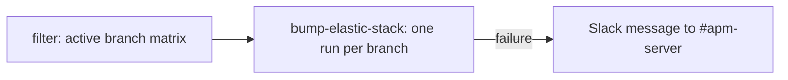

# bump-elastic-stack

Bumps the Elastic Stack snapshot build references on every active branch and opens one pull request per branch that changes.

## At a glance

| Item | Value |
|------|-------|
| Platform | GitHub Actions |
| Source | [`bump-elastic-stack.yml`](../bump-elastic-stack.yml) (workflow name `bump-elastic-stack-snapshot`) |
| Trigger | `workflow_dispatch`; schedule on weekdays |
| Runner | `ubuntu-latest` (`filter` job: `ubuntu-slim`) |

## Purpose

Keeps the Elastic Stack snapshot version pinned in the test infrastructure current on each active branch, using `updatecli` to open the pull requests.

## When it runs

- On demand through `workflow_dispatch`.
- On a schedule on weekdays.

## Execution flow

| Job | Runs when | Depends on | What it does |
|-----|-----------|------------|--------------|
| `filter` | Every run | None | Runs `elastic/oblt-actions/elastic/active-branches@v1` with `filter-branches: true` and outputs the branch matrix. Timeout is one minute. |
| `bump-elastic-stack` | For each branch in the matrix (`fail-fast: false`) | `filter` | Checks out the branch, creates a GitHub App token, and runs `updatecli --experimental apply` with `.ci/updatecli/bump-elastic-stack-snapshot.yml` and `.ci/updatecli/values.d/scm.yml`, with `BRANCH` set to the matrix branch. On failure, posts to Slack. |

## Inputs, outputs, and access

| Area | Details |
|------|---------|
| Inputs | None. The branch matrix comes from the active-branches action. |
| Outputs | One pull request per branch whose snapshot references change, labelled `automation`, `backport-skip`, and `dependencies`. |
| Permissions | Workflow token `contents: read`. The App token requests `contents: write` and `pull-requests: write`. |
| Secrets | `OBS_AUTOMATION_APP_ID`, `OBS_AUTOMATION_APP_PEM`, `SLACK_BOT_TOKEN` (names only). |

## Operational notes

- The updatecli configuration reads `build_id` from `https://storage.googleapis.com/artifacts-api/snapshots/<branch>.json`. It then rewrites `-SNAPSHOT` versions in `docker-compose.yml` and in `testing/infra/k8s/base/stack/apm-server.yaml`, `elasticsearch.yaml`, and `kibana.yaml`.
- The branch list is generated at run time, so this repository does not list which branches are covered.
- Source gap: the active-branches, updatecli, Slack, and GitHub App token actions are external (`elastic/oblt-actions`, `actions/create-github-app-token`). Their behavior is not verified here.
- Source gap: the snapshot endpoint is an external service and is not verified here.

## Sources

- [`.github/workflows/bump-elastic-stack.yml`](../bump-elastic-stack.yml)
- [`.ci/updatecli/bump-elastic-stack-snapshot.yml`](../../../.ci/updatecli/bump-elastic-stack-snapshot.yml)
- [`.ci/updatecli/values.d/scm.yml`](../../../.ci/updatecli/values.d/scm.yml)
- [`docker-compose.yml`](../../../docker-compose.yml)
- [`testing/infra/k8s/base/stack/`](../../../testing/infra/k8s/base/stack/)
