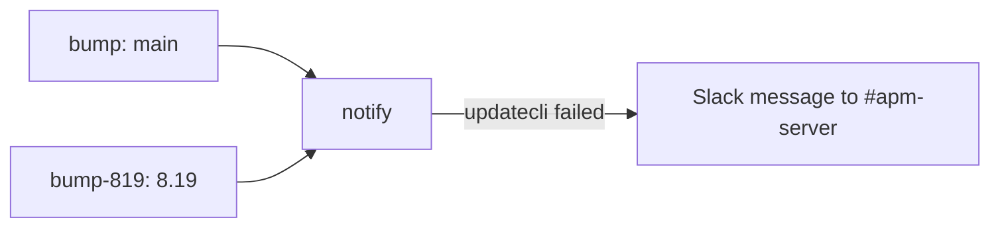

# bump-golang

Bumps the Go patch version in `go.mod` files on `main` and `8.19` through `updatecli`, opening one pull request per branch.

## At a glance

| Item | Value |
|------|-------|
| Platform | GitHub Actions |
| Source | [`bump-golang.yml`](../bump-golang.yml) |
| Trigger | `workflow_dispatch`; schedule on a weekly basis |
| Runner | `ubuntu-latest` |

## Purpose

Keeps the Go toolchain version current on the branches that ship it. The `main` run uses a fixed label, `backport-active-9`, and the `8.19` run uses `backport-skip`.

## When it runs

- On demand through `workflow_dispatch`.
- On a weekly schedule.

## Execution flow

| Job | Runs when | Depends on | What it does |
|-----|-----------|------------|--------------|
| `bump` | Every run | None | Checks out the workflow ref (`main`), creates a GitHub App token, and runs `updatecli --experimental apply` with `.ci/updatecli/bump-golang.yml`, `GITHUB_BRANCH=main`, and `GITHUB_LABELS=backport-active-9`. |
| `bump-819` | Every run | None | Checks out `8.19`, creates a GitHub App token, and runs `updatecli apply` (without `--experimental`) with the same configuration, `GITHUB_BRANCH=8.19`, and `GITHUB_LABELS=backport-skip`. |
| `notify` | Always, after both bump jobs | `bump`, `bump-819` | Runs `elastic/oblt-actions/check-dependent-jobs@v1`. If it reports a failure, posts to Slack. |

## Inputs, outputs, and access

| Area | Details |
|------|---------|
| Inputs | None. |
| Outputs | Pull requests on `main` and `8.19` that update the Go version. Labels: `automation`, `dependencies`, and the branch-specific label from `GITHUB_LABELS`. |
| Permissions | Workflow token `contents: read`. Each bump job's App token requests `contents: write` and `pull-requests: write`. |
| Secrets | `OBS_AUTOMATION_APP_ID`, `OBS_AUTOMATION_APP_PEM`, `SLACK_BOT_TOKEN` (names only). |

## Operational notes

- The updatecli configuration reads the minor version from `go.mod` and selects the latest `go1.<minor>.*` release from `golang/go`. It runs only when the `golang` Docker image tag for that version is published and `go.mod` differs from it.
- The target runs `make update-go-version`, which runs `go get go@<major.minor>` and `go get toolchain@none` in each `go.mod` (see [`script/update_go_version.sh`](../../../script/update_go_version.sh)).
- The `8.19` job has no `--experimental` flag, unlike the `main` job.
- Source gap: the `updatecli/run`, `check-dependent-jobs`, and Slack actions are external (`elastic/oblt-actions`). Their behavior is not verified here.
- Source gap: the `golang/go` release list and the `golang` Docker image are external services and are not verified here.

## Sources

- [`.github/workflows/bump-golang.yml`](../bump-golang.yml)
- [`.ci/updatecli/bump-golang.yml`](../../../.ci/updatecli/bump-golang.yml)
- [`.ci/updatecli/values.d/scm.yml`](../../../.ci/updatecli/values.d/scm.yml)
- [`script/update_go_version.sh`](../../../script/update_go_version.sh)
- [`Makefile`](../../../Makefile) (`update-go-version` target)
