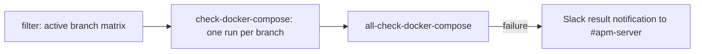

# check-docker-compose

Checks that the `-SNAPSHOT` image references in `docker-compose.yml` match the latest Elastic snapshot version on every active branch.

## At a glance

| Item | Value |
|------|-------|
| Platform | GitHub Actions |
| Source | [`check-docker-compose.yml`](../check-docker-compose.yml) |
| Trigger | `workflow_dispatch`; schedule on a weekly basis |
| Runner | `ubuntu-latest` (`filter` job: `ubuntu-slim`) |

## Purpose

Detects when the snapshot images pinned in `docker-compose.yml` fall behind the latest snapshot for each active branch.

## When it runs

- On demand through `workflow_dispatch`.
- On a weekly schedule.

## Execution flow

| Job | Runs when | Depends on | What it does |
|-----|-----------|------------|--------------|
| `filter` | Every run | None | Runs `elastic/oblt-actions/elastic/active-branches@v1` with `filter-branches: true` and outputs the branch matrix. Timeout is one minute. |
| `check-docker-compose` | For each branch in the matrix (`fail-fast: false`) | `filter` | Checks out the branch, sets up Go from `go.mod`, and runs `make check-docker-compose`. |
| `all-check-docker-compose` | Always, after the check jobs | `check-docker-compose` | Runs `elastic/oblt-actions/check-dependent-jobs@v1`, then runs its `isSuccess` output as a shell command, so the job fails when the value is `false`. On failure, posts a result notification to Slack. |

## Inputs, outputs, and access

| Area | Details |
|------|---------|
| Inputs | None. The branch matrix comes from the active-branches action. |
| Outputs | Pass or fail for each branch, and one aggregate result. |
| Permissions | Workflow token `contents: read`. |
| Secrets | `SLACK_BOT_TOKEN` (name only). |

## Operational notes

- `make check-docker-compose` runs `script/check_docker_compose.sh $(BEATS_VERSION)`. The workflow does not set `BEATS_VERSION`, so each branch's own Makefile value is used (`main` by default; release branches set it to their version).
- The script asks `script/latest_snapshot_version.sh` for the latest snapshot of that version. If there is no snapshot yet, it exits successfully.
- It compares each `image: docker.elastic.co/...-SNAPSHOT` in `docker-compose.yml` with the snapshot version, ignoring the build id. Images without `-SNAPSHOT` are skipped. It fails on the first out-of-date image.
- Source gap: the snapshot service queried by `latest_snapshot_version.sh` is external and is not verified here.
- Source gap: the `elastic/oblt-actions` actions and the Slack notification are external. Their behavior is not verified here.

## Sources

- [`.github/workflows/check-docker-compose.yml`](../check-docker-compose.yml)
- [`Makefile`](../../../Makefile) (`check-docker-compose` target)
- [`script/check_docker_compose.sh`](../../../script/check_docker_compose.sh)
- [`script/latest_snapshot_version.sh`](../../../script/latest_snapshot_version.sh)
- [`docker-compose.yml`](../../../docker-compose.yml)
