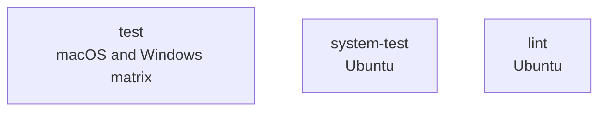

# CI (docs-only)

A placeholder CI workflow for pull requests that change documentation or image files. It reports the same check names as [`ci.yml`](ci.yml.md) without running any tests or lint.

## At a glance

| Field | Value |
|---|---|
| Definition | [`ci-docs.yml`](../ci-docs.yml) |
| Triggers | Pull requests that change at least one `**.md`, `**.asciidoc`, `**.png`, or `**.svg` file; merge queue (`merge_group`) |
| Path filter | Negated `paths-ignore`: the workflow runs only if the pull request includes a change to a documentation or image file matching one of the four patterns above. |
| Token permissions | `contents: read` |
| Secrets | None |
| Runners | `macos-latest`, `windows-latest`, `ubuntu-latest` |

## Purpose

Lets required status checks from [`ci.yml`](ci.yml.md) pass on documentation-only changes. The jobs only print a message and do not run tests, system tests, or linters.

## When it runs

- On pull requests that change at least one documentation or image file, even when code files also change.
- On merge queue checks.

## Execution flow

All three jobs start in parallel. Each one runs a single `echo` step.

| Job | Runs when | Depends on | What it does |
|---|---|---|---|
| `test` | Always | None | Prints `No tests required to run` on a macOS and Windows matrix. |
| `system-test` | Always | None | Prints `No tests required to run` on Ubuntu. |
| `lint` | Always | None | Prints `No lint required to run` on Ubuntu. |

## Inputs, outputs, and access

| Item | Details |
|---|---|
| Inputs | Pull request or merge group context only. |
| Outputs | Placeholder status checks. No artifacts. |
| Permissions | Workflow token: `contents: read`. |
| Secrets | None. |

## Operational notes

- The `paths-ignore` expression must match the one in [`ci.yml`](../ci.yml). Docs-only changes run only this workflow, code-only changes run only `ci.yml`, and mixed changes run both.
- The job names match `ci.yml` (`test`, `system-test`, `lint`) so that the same required checks are reported for docs-only changes.
- This workflow has no `ci.yml` jobs for FIPS, packaging, or integration server tests. Those checks are not reported here.

## Sources

- Workflow: [`ci-docs.yml`](../ci-docs.yml)
- Companion workflow: [`ci.yml`](../ci.yml)
- Source gaps: none for this workflow. Branch protection and required-check settings were not in the checked-in files and were not verified.
