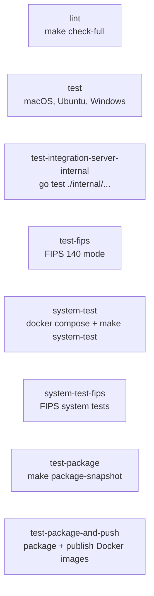

# CI

The main continuous integration pipeline for apm-server: lint, unit tests on three operating systems, FIPS tests, system tests, and package builds with optional Docker image publishing.

## At a glance

| Field | Value |
|---|---|
| Definition | [`ci.yml`](../ci.yml) |
| Triggers | Push to `main`, `7.1*`, `8.*`, `9.*`; pull requests; merge queue (`merge_group`) |
| Path filter | Skipped when all changes match `**.md`, `**.asciidoc`, `**.png`, `**.svg` |
| Token permissions | `contents: read` |
| Secrets | `ELASTIC_DOCKER_REGISTRY`, `ELASTIC_DOCKER_USERNAME`, `ELASTIC_DOCKER_PASSWORD` |
| Runners | `ubuntu-latest`, `macos-latest`, `windows-2025` |

## Purpose

Validates every change to apm-server before merge. It runs the Makefile `check-full`, `test`, `system-test`, and `package-snapshot` targets, and it publishes Docker images for pushes, merge-queue runs, and non-fork, non-Dependabot pull requests.

## When it runs

- On push to `main`, `7.1*`, `8.*`, and `9.*` branches, unless only documentation or image files changed.
- On pull requests, unless only documentation or image files changed.
- On merge queue checks (`merge_group`).

The companion [`ci-docs.yml`](ci-docs.yml.md) workflow runs for documentation-only pull requests instead.

## Execution flow

No job declares `needs`, so all jobs start in parallel. `test-package-and-push` runs only when its `if` condition is met.

| Job | Runs when | Depends on | What it does |
|---|---|---|---|
| `lint` | Always | None | Runs `make check-full` on Ubuntu. This target runs `update`, `check`, and `staticcheck`. |
| `test` | Always | None | Runs `make test` on a three-OS matrix (`macos-latest`, `ubuntu-latest`, `windows-2025`). |
| `test-integration-server-internal` | Always | None | Runs `go test -v -race ./internal/...` in `integrationservertest` with placeholder environment values. It does not run the upgrade tests. |
| `test-fips` | Always | None | Runs `make test` with `GOTAGS=requirefips`, `GOFIPS140=latest`, and `GODEBUG=fips140=only`. |
| `system-test` | Always | None | Starts the Docker Compose services (`docker compose up -d`) and runs `make apm-server` in parallel, then runs `make system-test`. Sets up Go from `systemtest/go.mod`. |
| `system-test-fips` | Always | None | Same flow as `system-test` with FIPS settings. |
| `test-package` | Always | None | Runs `make package-snapshot`. |
| `test-package-and-push` | Not a pull request, or a non-fork pull request that is not from Dependabot | None | Logs in to the Elastic Docker registry, runs `make package-snapshot` with `GENERATE_WOLFI_IMAGES=true`, then runs `make publish-docker-images`. |

The `system-test` jobs use `docker compose` with [`docker-compose.yml`](../../../docker-compose.yml) at the repository root.

### Make targets used

| Target | Definition |
|---|---|
| `check-full` | [`Makefile`](../../../Makefile) line 136. Prerequisites: `update`, `check`, `staticcheck`. |
| `check` | [`Makefile`](../../../Makefile) line 142. Prerequisites: `check-fmt`, `check-headers`, `check-git-diff`, `check-fips-deps`. |
| `test` | [`Makefile`](../../../Makefile) line 118. |
| `system-test` | [`Makefile`](../../../Makefile) line 122. |
| `package-snapshot` | [`packaging.mk`](../../../packaging.mk) line 228. Included by the root Makefile. Subtargets were not traced. |
| `publish-docker-images` | [`packaging.mk`](../../../packaging.mk) line 240. Runs `docker push --all-tags` on the internal Docker image. |

## Inputs, outputs, and access

| Item | Details |
|---|---|
| Inputs | Repository code, `go.mod` files, and the event context. |
| Outputs | Test results, packaged artifacts from `make package-snapshot`, and images pushed to the Elastic Docker registry (see `test-package-and-push`). |
| Permissions | Workflow token: `contents: read`. The publish job uses registry credentials from secrets. |
| Secrets | `ELASTIC_DOCKER_REGISTRY`, `ELASTIC_DOCKER_USERNAME`, `ELASTIC_DOCKER_PASSWORD`. The `GH_TOKEN` environment variable uses `github.token`, not a repository secret. |

## Operational notes

- The `paths-ignore` list must match the one in [`ci-docs.yml`](../ci-docs.yml); the two workflows select complementary sets of changes.
- `test-integration-server-internal` only runs unit tests in `integrationservertest/internal`. Upgrade tests run in [`integration-server-test.yml`](../integration-server-test.yml).
- The FIPS jobs set `GOFIPS140` and `GODEBUG` values inline in the workflow.
- Setup actions in this workflow are external. See Sources.

## Sources

- Workflow: [`ci.yml`](../ci.yml)
- Make targets: [`Makefile`](../../../Makefile), [`packaging.mk`](../../../packaging.mk)
- Compose file: [`docker-compose.yml`](../../../docker-compose.yml)
- Source gaps: external actions (`actions/checkout`, `actions/setup-go`, `docker/login-action`, and `elastic/oblt-actions` steps) are not checked in. The `package-snapshot` subtargets and the Docker publish logic in `packaging.mk` were not traced in full.
