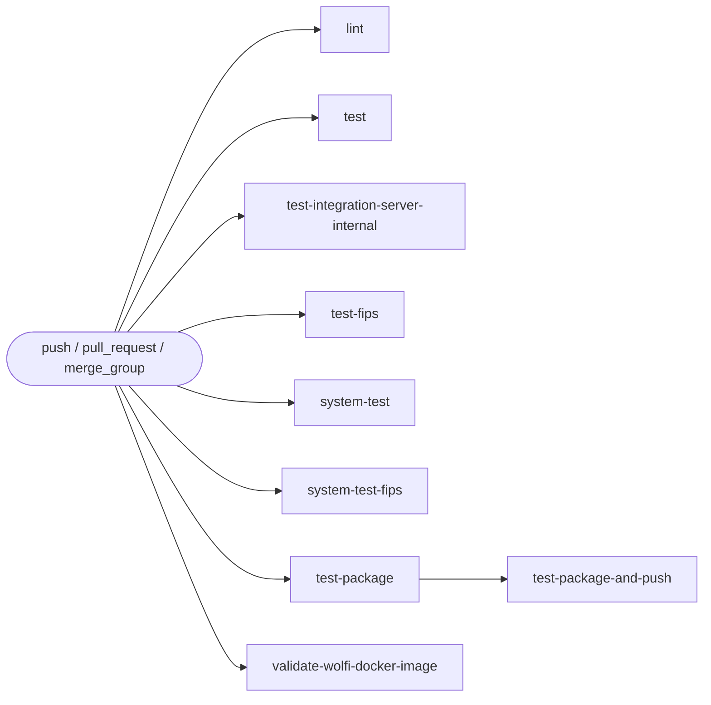

# ci

The main GitHub Actions CI for APM Server: linting, unit tests, FIPS tests, system tests, packaging, and Docker image publishing.

## At a glance

| Item | Value |
|------|-------|
| Definition | [`ci.yml`](../ci.yml) |
| Triggers | `push` to `main`, `7.1*`, `8.*`, `9.*`; `pull_request`; `merge_group` |
| Path filter | Skipped when a change only touches `**.md`, `**.asciidoc`, `**.png`, or `**.svg` |
| Token permissions | `contents: read` (workflow level) |
| Secrets | `ELASTIC_DOCKER_REGISTRY`, `ELASTIC_DOCKER_USERNAME`, `ELASTIC_DOCKER_PASSWORD` (only in `test-package-and-push`) |
| Runners | `ubuntu-latest`, plus `macos-latest` and `windows-2025` for `test` |

## Purpose

Validates every change to APM Server with lint, tests on three operating systems, FIPS-mode tests, and the docker-compose system tests. On trusted refs it also builds the snapshot packages and publishes the Docker images.

## When it runs

- On pushes to `main`, `7.1*`, `8.*`, and `9.*`, unless the push only changes ignored paths.
- On every pull request, unless the change only touches ignored paths. Pull requests from forks and Dependabot run the checks but do not publish images.
- On `merge_group` events.

The companion workflow [`ci-docs.yml`](./ci-docs.yml.md) runs for documentation-only changes and must keep the same ignore list.

## Execution flow

## Jobs

| Job | Runs on | Condition | Main command |
|-----|---------|-----------|--------------|
| `lint` | `ubuntu-latest` | Always | `make check-full` |
| `test` | matrix: macOS, Ubuntu, Windows 2025 | Always | `go test -v -race ./...` |
| `test-integration-server-internal` | `ubuntu-latest` | Always | `go test -v -race ./internal/...` in `integrationservertest` with dummy values |
| `test-fips` | `ubuntu-latest` | Always | `go test -v -race -tags=requirefips ./...` with `GOFIPS140=latest` |
| `system-test` | `ubuntu-latest` | Always | `docker compose up -d`, `make apm-server`, then `make system-test` |
| `system-test-fips` | `ubuntu-latest` | Always | Same as `system-test` with `-tags=requirefips` and FIPS env |
| `test-package` | `ubuntu-latest` | Always | `make package-snapshot` |
| `test-package-and-push` | `ubuntu-latest` | Not a pull request, or a pull request from the same repository that is not from `dependabot[bot]` | `make package-snapshot`, then `make publish-docker-images` |
| `validate-wolfi-docker-image` | `ubuntu-latest` | Fork pull request, or `dependabot[bot]` | Fails when `.go-version` changed, with a note to validate the image upstream |

## Inputs, outputs, and access

| Area | Details |
|------|---------|
| Inputs | Branch, tag, and pull request events. No `workflow_dispatch` inputs. |
| Outputs | No workflow outputs. Packages are built locally, and images are pushed only by `test-package-and-push`. |
| Permissions | `contents: read` for all jobs. `test-package-and-push` logs in to the Elastic container registry. |
| Secrets | Names only: `ELASTIC_DOCKER_REGISTRY`, `ELASTIC_DOCKER_USERNAME`, `ELASTIC_DOCKER_PASSWORD`. Fork pull requests cannot access them. |
| Environment | `GENERATE_WOLFI_IMAGES=true` for `test-package-and-push`. `GOFIPS140=latest` and `GODEBUG=fips140=only,tlsmlkem=0` for FIPS jobs. |

## Operational notes

- Go versions come from `go.mod` (main module), `integrationservertest/go.mod`, and `systemtest/go.mod`.
- Caches use the Go module cache keyed by the relevant `go.mod` files.
- The FIPS jobs disable the `X25519MLKEM768` TLS key exchange until an upstream Go issue is resolved. The source file records this as a TODO.
- `validate-wolfi-docker-image` always fails for a `.go-version` change from a fork or Dependabot. This is intentional: the image must be validated from an upstream branch.
- The docs-only workflow [`ci-docs.yml`](./ci-docs.yml.md) defines jobs with the same names as no-ops, so checks with those names still report on documentation-only changes.

## Sources

- [`.github/workflows/ci.yml`](../ci.yml)
- [`.github/workflows/ci-docs.yml`](../ci-docs.yml)
- Makefile targets (`check-full`, `package-snapshot`, `publish-docker-images`, `system-test`, `apm-server`) are called but not inspected for this page. See source gaps in the PR description.
