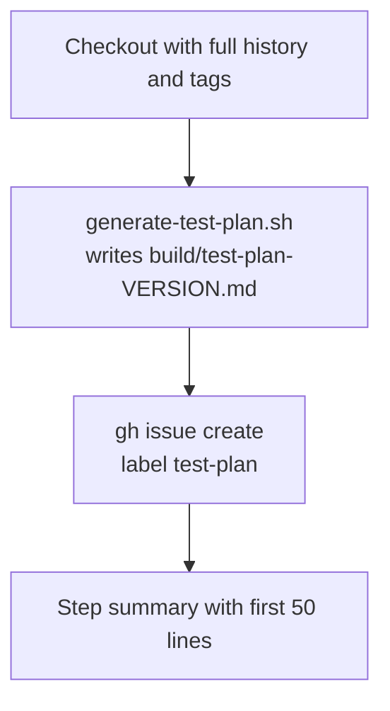

# Create Test Plan

Generates a release test plan from the commits on the release branch and creates a GitHub issue with the plan, labelled `test-plan`.

## At a glance

| Field | Value |
|---|---|
| Definition | [`create-test-plan.yml`](../create-test-plan.yml) |
| Triggers | Manual (`workflow_dispatch`) with a required `upcoming_release` input (`x.y.z`) |
| Path filter | None |
| Token permissions | `contents: read`, `issues: write`, `pull-requests: read` |
| Secrets | None. The workflow uses `github.token`. |
| Runners | `ubuntu-latest` |

## Purpose

Builds the test plan for an upcoming apm-server release. The plan lists the commits in the release window, grouped by area, and includes the changes in the external components that apm-server depends on. The workflow files the plan as an issue so that it can be tracked.

## When it runs

- **Manually**, with `workflow_dispatch`. The input is the upcoming release version, for example `9.2.6` (patch) or `9.3.0` (minor).

## Execution flow

| Job | Runs when | Depends on | What it does |
|---|---|---|---|
| `analyze-commits` | Always | None | Checks out the repository with `fetch-depth: 0` and tags. Runs [`.ci/scripts/generate-test-plan.sh`](../../../.ci/scripts/generate-test-plan.sh) with the input version. Creates an issue titled `<version> Test Plan` from the generated file, with the `test-plan` label. Writes a step summary showing the issue URL and the first 50 lines of the plan. |

### Script behavior

[`generate-test-plan.sh`](../../../.ci/scripts/generate-test-plan.sh) takes a version in `x.y.z` form and does the following:

| Step | Details |
|---|---|
| Validate input | Requires `x.y.z`. Rejects `x.0.0` releases. |
| Choose release type | `z` = 0 is a minor release, which compares against the previous minor release. Otherwise it is a patch release, which compares against `v<x.y.(z-1)>`. |
| Check refs | Requires the tag for the previous release and `origin/<x.y>`. For minor releases, it also requires `origin/<previous x.y>` and `origin/main`. |
| Collect commits | Patch: `git log` between the previous tag and `origin/<x.y>`. Minor: commits after the feature-freeze point on the release branch, plus commits before it that are not backported PRs already in the previous release. Minor releases need `gh` and `jq` and query the pull requests for the previous branch. |
| Compare dependencies | Reads the `go.mod` files from the previous tag and the release branch. For `apm-aggregation`, `go-docappender/v2`, and `apm-data`, it clones the repository into `build/test-plan-repos`, and lists the commits in the version range. |
| Elasticsearch plugin | Clones `elastic/elasticsearch` into the same cache, and lists commits that touch `x-pack/plugin/apm-data` between the previous tag and the release branch. |
| Write output | Groups the commits into sections, such as apm-server changes, dependency updates, and PGO changes, and writes `build/test-plan-<version>.md`. |

## Inputs, outputs, and access

| Item | Details |
|---|---|
| Inputs | `upcoming_release` (string, required), for example `9.2.6`. |
| Outputs | Issue with the title `<version> Test Plan` and the `test-plan` label. Step summary. The intermediate files under `build/`. |
| Permissions | `contents: read`, `issues: write`, `pull-requests: read` |
| Secrets | None. `GH_TOKEN` is set from `github.token`. |

## Operational notes

- The workflow fails when the previous release tag or the release branch does not exist in the checkout.
- Minor-release plans call the GitHub API with `gh` for the pull requests on the previous release branch. They also need `jq`.
- The external repositories are cloned with `--filter=blob:none` into `build/test-plan-repos`. A clone that fails is skipped without failing the script, and its section is left empty.
- Dependency sections are produced only when the referenced module version changed between the two refs.

## Sources

- Workflow: [`create-test-plan.yml`](../create-test-plan.yml)
- Script: [`.ci/scripts/generate-test-plan.sh`](../../../.ci/scripts/generate-test-plan.sh)
- Source gaps: the runner image tools (`gh`, `jq`, `git`) are assumed to be available on `ubuntu-latest`, but the image contents are not in this repository. The script's full section layout and the category rules (`is_dep_message`, `dep_group_for_message`, `is_pgo_message`) were not read line by line. Clone access for the external repositories depends on the runner network and was not verified.
