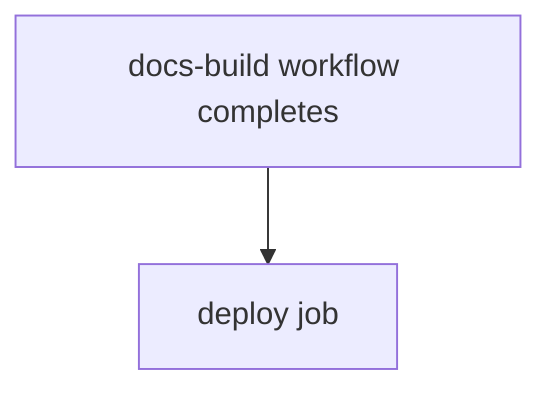

# docs-deploy

Deploys documentation after the `docs-build` workflow completes, by calling a reusable workflow from `elastic/docs-actions` with Vale linting enabled.

## At a glance

| | |
| --- | --- |
| Platform | GitHub Actions |
| Source | [`.github/workflows/docs-deploy.yml`](../docs-deploy.yml) |
| Trigger | `workflow_run` of `docs-build`, activity type `completed` |

## Purpose

The file chains deployment to the `docs-build` workflow, so deployment is triggered by that workflow finishing rather than by a repository event. The deployment itself is performed by the external reusable workflow `elastic/docs-actions/.github/workflows/docs-deploy.yml@v1`; its steps are not in this repository (see Operational notes). The file does not state why deployment is separated from the build.

## When it runs

- After each completed run of the `docs-build` workflow.
- The file declares no condition on the triggering run's conclusion, branch, or event, and no path filter.

## Execution flow

| Job | Runs when | Depends on | What it does |
| --- | --- | --- | --- |
| `deploy` | After `docs-build` completes | `docs-build` workflow run (via `workflow_run`); no `needs` within this file | Calls `elastic/docs-actions/.github/workflows/docs-deploy.yml@v1` with `enable-vale-linting: true`. |

## Inputs, outputs, and access

| Item | Details |
| --- | --- |
| Inputs | `enable-vale-linting: true` passed to the reusable workflow. |
| Outputs | Not declared in this file. The reusable workflow's outputs are not verifiable here. |
| Permissions | Workflow level: `contents: read`, `deployments: write`, `id-token: write`, `pull-requests: write`, `actions: read`. No job-level permissions declared. |
| Secrets | None passed explicitly. |

## Operational notes

- Because the trigger is `workflow_run` with no conditions, the file does not restrict deployment to successful builds. Whether the reusable workflow checks the triggering run's result is a source gap.
- Source gap: the reusable workflow `elastic/docs-actions/.github/workflows/docs-deploy.yml@v1` is external. Its deployment target, the run it reads artifacts from, and any secrets it requires are not verifiable from this repository.

## Sources

- Workflow: [`.github/workflows/docs-deploy.yml`](../docs-deploy.yml)
- Upstream build workflow: [`.github/workflows/docs-build.yml`](../docs-build.yml)
- Source gap: `elastic/docs-actions` reusable workflows are external and are not listed as sources.
