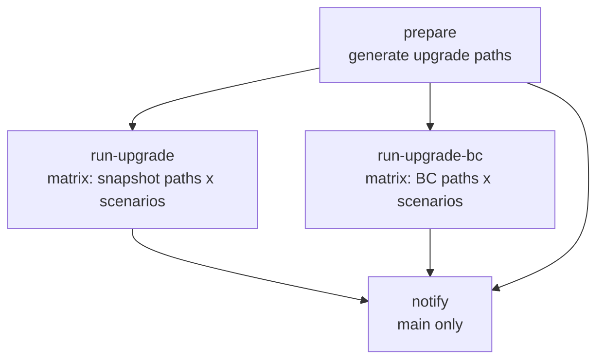

# Integration Server Test

Runs the integration server upgrade tests in `integrationservertest` against Elastic Cloud, once for each upgrade path returned by the path generator, across the Default and Reroute scenarios.

## At a glance

| Field | Value |
|---|---|
| Definition | [`integration-server-test.yml`](../integration-server-test.yml) |
| Triggers | Manual (`workflow_dispatch`); runs on a weekday schedule |
| Path filter | None |
| Token permissions | `contents: read`, `id-token: write` |
| Secrets | `SLACK_BOT_TOKEN`, `EC_API_KEY` (read from Secret Manager, not a repository secret) |
| Runners | `ubuntu-latest` |

## Purpose

Verifies that apm-server upgrades work across supported stack versions. The workflow generates upgrade paths first, then runs one test job per path and scenario. Results are reported to Slack for `main`.

## When it runs

- **Manually**, with the two inputs below.
- **On a weekday schedule** (Monday to Friday).

Each of the two test jobs runs only when its input is not set to `false`. The schedule does not set inputs, so both jobs run.

## Execution flow

| Job | Runs when | Depends on | What it does |
|---|---|---|---|
| `prepare` | Always | None | Checks out the repository and runs the [`generate-upgrade-paths`](../generate-upgrade-paths/action.yml) action. Outputs `snapshot_upgrade_paths` and `bc_upgrade_paths`. |
| `run-upgrade` | `run-upgrade-tests` is not `false` | `prepare` | Runs one job per snapshot upgrade path and scenario (`Default`, `Reroute`). `fail-fast` is `false`. |
| `run-upgrade-bc` | `run-upgrade-bc-tests` is not `false`, and the BC path list is not `[]` | `prepare` | Runs one job per BC upgrade path and scenario. `fail-fast` is `false`. |
| `notify` | Always, on `main` only | `prepare`, `run-upgrade`, `run-upgrade-bc` | Uses `elastic/oblt-actions/check-dependent-jobs` to compute the status. Skipped jobs count as success. Posts the result to `#apm-server` with the Slack action. |

Each test job runs the [`setup-integration-server-test`](../setup-integration-server-test/action.yml) action, then sets `TF_VAR_CREATED_DATE` and runs `make integration-server-test/upgrade` with `SCENARIO` and `UPGRADE_PATH` from the matrix.

### Composite actions

| Action | Used by | What it does |
|---|---|---|
| [`setup-integration-server-test`](../setup-integration-server-test/action.yml) | `generate-upgrade-paths`, `run-upgrade`, `run-upgrade-bc` | Installs Terraform (`TERRAFORM_VERSION`, 1.10.2 in this workflow) with the wrapper disabled. Sets up Go from `integrationservertest/go.mod`. Authenticates to Google Cloud with `elastic/oblt-actions/google/auth`. Writes `EC_TARGET=qa` to `GITHUB_ENV`. Reads `EC_API_KEY` from Secret Manager. |
| [`generate-upgrade-paths`](../generate-upgrade-paths/action.yml) | `prepare` | Runs the setup action, then [`script.sh`](../generate-upgrade-paths/script.sh). The script runs `go run ./scripts/genpath` in `integrationservertest` twice, once with `--snapshots=true` and once with `--snapshots=false`, and writes both lists to `GITHUB_OUTPUT`. |

### Make target used

| Target | Definition in the root [`Makefile`](../../../Makefile) |
|---|---|
| `integration-server-test/upgrade` | Requires `UPGRADE_PATH` and `SCENARIO`. Runs `go test -run=TestUpgrade/.*/$(SCENARIO) -v -timeout=90m -cleanup-on-failure=true -target="$(EC_TARGET)" -upgrade-path="$(UPGRADE_PATH)" ./` in `integrationservertest`. |

## Inputs, outputs, and access

| Item | Details |
|---|---|
| Inputs | `run-upgrade-tests` (boolean, default `true`): runs the snapshot upgrade jobs. `run-upgrade-bc-tests` (boolean, default `true`): runs the BC upgrade jobs. |
| Outputs | Job results in the workflow run. Slack messages to `#apm-server` for `main`. Test results come from `go test` in each job. |
| Environment | `TF_VAR_BRANCH` (`github.ref_name`), `TF_VAR_BUILD_ID`, `TF_VAR_ENVIRONMENT=ci`, `TF_VAR_REPO`, `TERRAFORM_VERSION=1.10.2`. |
| Permissions | `contents: read`, `id-token: write`. |
| Secrets | `SLACK_BOT_TOKEN`, `EC_API_KEY` (from Secret Manager). |

## Operational notes

- The `EC_TARGET` value is set to `qa` by the setup action. The Makefile default is `pro`, but the composite action overrides it for these jobs.
- The `snapshots` input of `generate-upgrade-paths` is declared but is not passed to `script.sh`. The script always generates both lists.
- The `run-upgrade-bc` job is skipped when the BC path list is `[]`.
- The Makefile also defines `integration-server-test/upgrade-all`, which runs every scenario for one path. This workflow does not use it.
- Internal unit tests for `integrationservertest` run in [`ci.yml`](../ci.yml), not here.

## Sources

- Workflow: [`integration-server-test.yml`](../integration-server-test.yml)
- Composite actions: [`setup-integration-server-test/action.yml`](../setup-integration-server-test/action.yml), [`generate-upgrade-paths/action.yml`](../generate-upgrade-paths/action.yml), [`generate-upgrade-paths/script.sh`](../generate-upgrade-paths/script.sh)
- Root Makefile: [`Makefile`](../../../Makefile), lines 350–372
- Test module: [`integrationservertest`](../../../integrationservertest)
- Source gaps: the `genpath` tool ([`integrationservertest/scripts/genpath`](../../../integrationservertest/scripts/genpath)) decides which versions appear in each list. Its logic was not read, so the content of the path lists is not described. External actions (`actions/checkout`, `hashicorp/setup-terraform`, `actions/setup-go`, `elastic/oblt-actions/*`, `google-github-actions/get-secretmanager-secrets`) are not checked in.
