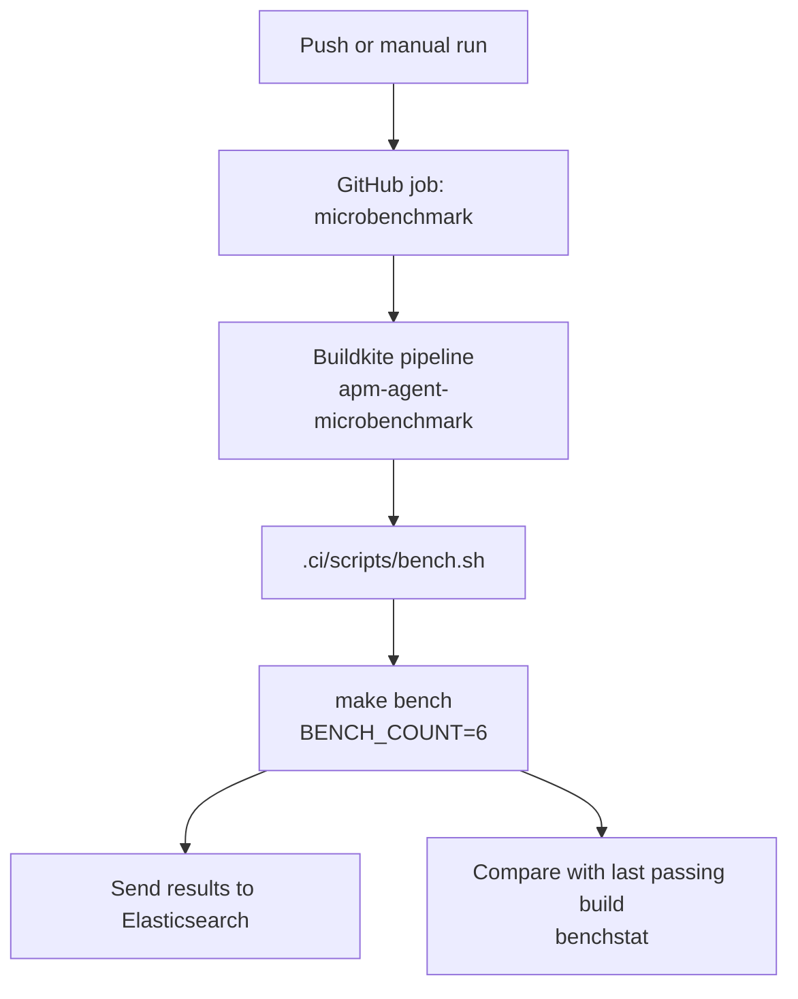

# Microbenchmark

Triggers a Buildkite pipeline that runs the Go microbenchmarks on each push to the main and release branches, then stores the results and a comparison against the previous passing build.

## At a glance

| Field | Value |
|---|---|
| Definition | [`microbenchmark.yml`](../microbenchmark.yml) |
| Triggers | Manual (`workflow_dispatch`); push to `main`, `8.*`, and `9.*` branches, ignoring Markdown and AsciiDoc changes |
| Path filter | Ignores `**.md` and `**.asciidoc` |
| Token permissions | `contents: read` |
| Secrets | `BUILDKITE_TOKEN` (passed to the Buildkite trigger action) |
| Runners | `ubuntu-latest` (trigger only; the benchmark runs on the Buildkite pipeline `apm-agent-microbenchmark`) |

## Purpose

Runs the Go benchmarks for apm-server and records their results in Elasticsearch so changes in performance can be tracked over time. The Buildkite run also compares the results with the last passing build and publishes the difference.

## When it runs

- **On push** to `main`, `8.*`, or `9.*` branches, unless the change only touches Markdown or AsciiDoc files.
- **Manually**, with `workflow_dispatch`.

## Execution flow

| Job | Runs when | Depends on | What it does |
|---|---|---|---|
| `microbenchmark` | Always, with a 5-minute timeout | None | Runs the `elastic/oblt-actions/buildkite/run@v1` action. It triggers the `apm-agent-microbenchmark` pipeline with the environment variables `script=.ci/scripts/bench.sh`, `repo=apm-server`, `sha=<commit>`, `BRANCH_NAME=<branch>`, and `REPO=apm-server`. |

### Buildkite script steps

The Buildkite pipeline runs [`.ci/scripts/bench.sh`](../../../.ci/scripts/bench.sh). Its steps are:

| Step | Details |
|---|---|
| Validate environment | Requires `BUILDKITE_AGENT_ACCESS_TOKEN`, `BUILDKITE_ORGANIZATION_SLUG`, `BUILDKITE_PIPELINE_NAME`, `ES_USER_SECRET`, `ES_PASS_SECRET`, `ES_URL_SECRET`, and `REPO`. The script exits if any is missing. |
| Set up Go | Reads the Go version from `go.mod`, installs it with `gvm`, and sets a teardown trap that restores write permissions on the Go module cache. |
| Run benchmarks | Runs `BENCH_COUNT=6 make bench` and writes the output to a result file. |
| Upload and index results | When `CI` is `true`, uploads the result file as a Buildkite artifact and sends it to Elasticsearch with `gobench`. |
| Compare with previous build | Downloads the artifact from the last passing build through the Buildkite REST API. If one exists, it runs `benchstat`, keeps only lines that changed, and uploads the diff as an artifact. |

The `make bench` target is defined in the root [`Makefile`](../../../Makefile) at line 155. It runs `go test` with `-benchmem`, `-run=XXX`, `-benchtime=$(BENCH_BENCHTIME)`, and `-bench='.*'` across `./...`. `BENCH_COUNT` defaults to `1` in the Makefile.

## Inputs, outputs, and access

| Item | Details |
|---|---|
| Inputs | None from the workflow file. Trigger inputs are the `sha` and `BRANCH_NAME` values passed to Buildkite. |
| Outputs | Benchmark result artifact, benchmark diff artifact (when a previous build exists), and indexed results in Elasticsearch. |
| Permissions | `contents: read` |
| Secrets | `BUILDKITE_TOKEN` (used by the trigger step). The Elasticsearch and Buildkite agent values used by `bench.sh` are not in the repository. |

## Operational notes

- The 5-minute timeout applies only to the GitHub job that triggers Buildkite. It does not limit the benchmark run.
- The comparison only runs when `CI` is `true`. It needs a previous passing build of the same pipeline and a result artifact with the same name.
- `bench.sh` runs `go install` for `gobench`, `golang.org/x/perf/cmd/...`, and downloads `gvm` from GitHub when it sets up Go.
- The `apm-agent-microbenchmark` Buildkite pipeline definition is not in this repository.

## Sources

- Workflow: [`microbenchmark.yml`](../microbenchmark.yml)
- Script: [`.ci/scripts/bench.sh`](../../../.ci/scripts/bench.sh)
- Root Makefile: [`Makefile`](../../../Makefile)
- Source gaps: the `apm-agent-microbenchmark` Buildkite pipeline definition and its agent configuration are not checked in. The values of `ES_URL_SECRET`, `ES_USER_SECRET`, `ES_PASS_SECRET`, and `BUILDKITE_TOKEN_SECRET` are supplied by the pipeline and were not verified. The external action `elastic/oblt-actions/buildkite/run@v1` is not checked in. The `gobench` and `benchstat` tools are installed from external modules and their behavior was not verified.
