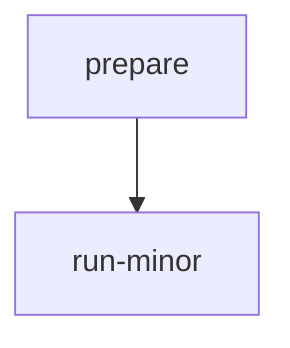

# run-minor-release

Starts a minor release: creates the `<major>.<minor>` release branch from `main`, updates version references, adds the backport rule and label, updates the changelog, and opens a pull request into `main`.

## At a glance

| | |
| --- | --- |
| Platform | GitHub Actions |
| Source | [`run-minor-release.yml`](../run-minor-release.yml) |
| Trigger | Manual only (`workflow_dispatch`) with a required `version` input |

## Purpose

Automates the steps for a new minor version. The workflow validates the version, then runs `make minor-release` (see [`release.mk`](../../../release.mk)). The release branch is created from `main`, and the pull request that moves `main` to the next minor version is opened against `main`.

## When it runs

Runs only on demand through `workflow_dispatch`. It has no schedule and no push or pull request triggers. The concurrency group is the workflow name and cancel-in-progress is not set, so a new run queues behind an active run instead of cancelling it.

## Execution flow

The `run-minor` job starts only after `prepare` succeeds. `prepare` validates the version and provides the outputs that `run-minor` uses.

| Job | Runs when | Depends on | What it does |
| --- | --- | --- | --- |
| `prepare` | On dispatch | None declared | Checks out the repository and runs the local composite [`prepare-release`](../prepare-release/action.yml) with `type: minor`. The composite posts a thread starter to Slack, sets `release-branch` (the version without its last component) and `release-version`, rejects versions that do not end in `.0`, and fails if the `v<version>` tag already exists on the remote. |
| `run-minor` | After `prepare` succeeds | `prepare` | Posts the feature-freeze message to the Slack thread, creates a GitHub App token, checks out with full history, configures git, imports the GPG key, runs `make minor-release` with `GH_TOKEN` set, and posts a success or failure message. |

`make minor-release` runs these steps in order (see [`release.mk`](../../../release.mk)):

1. Creates the `backport-<major>.<minor>` label on `elastic/apm-server`, forcing an update if it exists.
2. Creates the `<major>.<minor>` branch from `main`, or fetches it if it already exists on the remote. Sets the version in `cmd/intake-receiver/version.go` and `internal/version/version.go`, and sets `BEATS_VERSION` in the [`Makefile`](../../../Makefile) to `<major>.<minor>`. Commits "[Release] update version".
3. Creates `update-<version>` from `main`, adds a backport rule to [`.mergify.yml`](../../../.mergify.yml) if one is missing, sets the version to the next minor, and commits.
4. Updates the release notes through [`tools/scripts/changelog.sh`](../../../tools/scripts/changelog.sh) and commits.
5. Pushes the release branch to `origin` and opens a pull request from `update-<version>` into `main`, with the `release` label.

## Inputs, outputs, and access

| Item | Details |
| --- | --- |
| Inputs | `version` (required string): the new version, normally the version on `main`, in `major.minor.0` form. |
| Outputs | `prepare` outputs `release-branch`, `release-type`, `release-version`, and `slack-thread`. `make minor-release` pushes the release branch, creates the backport label, and opens a pull request into `main`. Slack messages are posted to `#apm-server`. |
| Permissions | Workflow level: `contents: read`. The `run-minor` job uses a GitHub App token with `contents: write` and `pull-requests: write`. Commits are created with `git commit --gpg-sign`. |
| Secrets | `SLACK_BOT_TOKEN`, `OBS_AUTOMATION_APP_ID`, `OBS_AUTOMATION_APP_PEM`, `GPG_PRIVATE_KEY`, `GPG_PASSPHRASE` |

## Operational notes

- Version checks: the composite rejects versions that do not end in `.0` and performs no other format validation. It runs `git ls-remote` to check for the tag, and any `ls-remote` failure other than a found tag counts as "not found".
- Failure handling: `prepare` failures post the failure reason to the Slack thread. `run-minor` failures post a generic message with a link to the run logs. The workflow has no cleanup or rollback, so branches, labels, and commits created before a failure remain.
- Pull request creation skips when a pull request with the `release` label already exists for the same head and base, unless `FORCE_PR_CREATION=true`. The `gh pr create` call ends with `|| echo "There is no changes"`, so a failed creation does not fail the step.
- The minor release does not set `BACKPORT_LABEL`, so the label argument passed to `gh pr create` is empty.
- `UPDATE_MERGIFY` is set only for major releases, and no target reads it. The mergify update runs for every minor and major release.
- `tools/scripts/changelog.sh` checks for a missing version with `test -z VERSION`, which tests a literal string and never triggers. The Makefile always passes `VERSION`.
- Source gap: `--reviewer "$(PROJECT_REVIEWERS)"` references a variable that is not defined in the checked-in sources. Its value is unknown.
- Source gap: the behavior of the external actions (`elastic/oblt-actions/slack/send@v1`, `elastic/oblt-actions/git/setup@v1`, `actions/create-github-app-token@v3`, `actions/checkout@v7`, and `crazy-max/ghaction-import-gpg`) is defined outside this repository and is not verified here.

## Sources

- Workflow: [`run-minor-release.yml`](../run-minor-release.yml)
- Composite: [`prepare-release/action.yml`](../prepare-release/action.yml)
- Release goals and helpers: [`release.mk`](../../../release.mk), included by the [`Makefile`](../../../Makefile)
- Changelog script: [`tools/scripts/changelog.sh`](../../../tools/scripts/changelog.sh)
- Version files: [`cmd/intake-receiver/version.go`](../../../cmd/intake-receiver/version.go), [`internal/version/version.go`](../../../internal/version/version.go)
- Mergify rules: [`.mergify.yml`](../../../.mergify.yml)
- Release notes updated by the changelog step: [`docs/release-notes/index.md`](../../../docs/release-notes/index.md), [`breaking-changes.md`](../../../docs/release-notes/breaking-changes.md), [`deprecations.md`](../../../docs/release-notes/deprecations.md)
