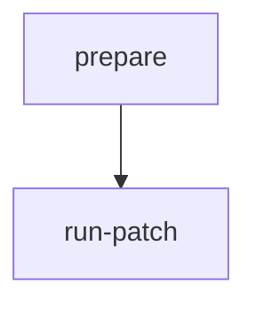

# run-patch-release

Starts a patch release: creates an update branch from the existing `<major>.<minor>` release branch, updates the version, and opens a pull request into that release branch.

## At a glance

| | |
| --- | --- |
| Platform | GitHub Actions |
| Source | [`run-patch-release.yml`](../run-patch-release.yml) |
| Trigger | Manual only (`workflow_dispatch`) with a required `version` input |

## Purpose

Automates the version bump for a patch release on an existing release branch. The workflow validates the version, then runs `make patch-release` (see [`release.mk`](../../../release.mk)). The pull request that the target opens is labeled `backport-skip` and is merged on request by the Release Manager.

## When it runs

Runs only on demand through `workflow_dispatch`. It has no schedule and no push or pull request triggers. The concurrency group is the workflow name and cancel-in-progress is not set, so a new run queues behind an active run instead of cancelling it.

## Execution flow

The `run-patch` job starts only after `prepare` succeeds. `prepare` validates the version and provides the outputs that `run-patch` uses. `run-patch` receives the version as the `BUMP_VERSION` environment variable.

| Job | Runs when | Depends on | What it does |
| --- | --- | --- | --- |
| `prepare` | On dispatch | None declared | Checks out the repository and runs the local composite [`prepare-release`](../prepare-release/action.yml) with `type: patch`. The composite posts a thread starter to Slack, sets `release-branch` (the version without its last component) and `release-version`, rejects versions that end in `.0`, and fails if the `v<version>` tag already exists on the remote. |
| `run-patch` | After `prepare` succeeds | `prepare` | Creates a GitHub App token, checks out with full history, configures git, imports the GPG key, runs `make patch-release` with `GH_TOKEN` and `BUMP_VERSION` set, and posts a success or failure message. |

`make patch-release` runs these steps in order (see [`release.mk`](../../../release.mk)):

1. Creates or checks out the `update-<version>` branch from the release branch.
2. Sets the version in `cmd/intake-receiver/version.go` and `internal/version/version.go`, and commits "`<major>.<minor>`: update versions to `<version>`" when there is a diff.
3. Pushes the update branch and opens a pull request from `update-<version>` into the release branch, with the `release` and `backport-skip` labels.

On success, the workflow posts that the pull requests to bump versions have been created, with a link to open release pull requests. On failure, it posts a message with a link to the run logs. This workflow does not post a feature-freeze message.

## Inputs, outputs, and access

| Item | Details |
| --- | --- |
| Inputs | `version` (required string): the patch version to release, in `major.minor.patch` form, for example `9.3.1`. The composite rejects versions that end in `.0`. |
| Outputs | `prepare` outputs `release-branch`, `release-type`, `release-version`, and `slack-thread`. `make patch-release` pushes the update branch and opens a pull request into the release branch. Slack messages are posted to `#apm-server`. |
| Permissions | Workflow level: `contents: read`. The `run-patch` job uses a GitHub App token with `contents: write` and `pull-requests: write`. Commits are created with `git commit --gpg-sign`. |
| Secrets | `SLACK_BOT_TOKEN`, `OBS_AUTOMATION_APP_ID`, `OBS_AUTOMATION_APP_PEM`, `GPG_PRIVATE_KEY`, `GPG_PASSPHRASE` |

## Operational notes

- The `run-patch` job checks out the default ref of the repository, not the release branch. The release branch is used by the make target through `RELEASE_BRANCH` and the `BASE` and `TARGET_BRANCH` values.
- Version checks: the composite rejects versions that end in `.0`. It runs `git ls-remote` to check for the tag, and any `ls-remote` failure other than a found tag counts as "not found".
- The update branch is reused if it already exists on the remote, and the commit step runs only when there is a diff.
- Pull request creation skips when a pull request with the `release` label already exists for the same head and base, unless `FORCE_PR_CREATION=true`. The `gh pr create` call ends with `|| echo "There is no changes"`, so a failed creation does not fail the step.
- Failure handling: `prepare` failures post the failure reason to the Slack thread. `run-patch` failures post a generic message with a link to the run logs. The workflow has no cleanup or rollback.
- Source gap: `--reviewer "$(PROJECT_REVIEWERS)"` references a variable that is not defined in the checked-in sources. Its value is unknown.
- Source gap: the behavior of the external actions (`elastic/oblt-actions/slack/send@v1`, `elastic/oblt-actions/git/setup@v1`, `actions/create-github-app-token@v3`, `actions/checkout@v7`, and `crazy-max/ghaction-import-gpg`) is defined outside this repository and is not verified here.

## Sources

- Workflow: [`run-patch-release.yml`](../run-patch-release.yml)
- Composite: [`prepare-release/action.yml`](../prepare-release/action.yml)
- Release goals and helpers: [`release.mk`](../../../release.mk), included by the [`Makefile`](../../../Makefile)
- Version files: [`cmd/intake-receiver/version.go`](../../../cmd/intake-receiver/version.go), [`internal/version/version.go`](../../../internal/version/version.go)
