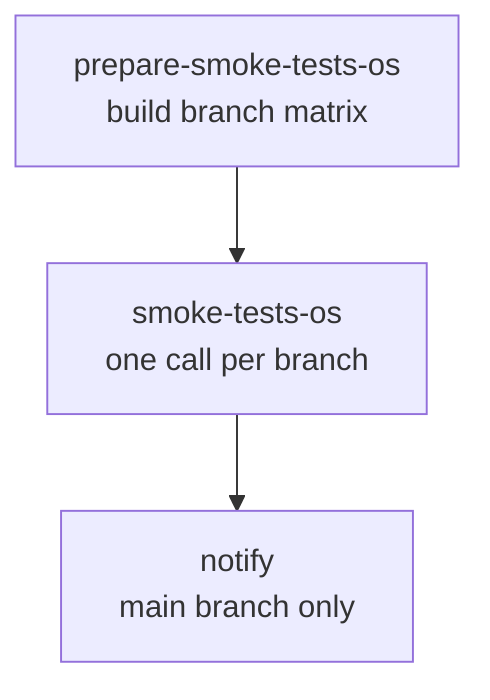

# Smoke Tests OS Scheduled

Runs the OS smoke tests on weekdays for every active release branch and posts the overall result to Slack from the main branch.

## At a glance

| Field | Value |
|---|---|
| Definition | [`smoke-tests-os-sched.yml`](../smoke-tests-os-sched.yml) |
| Triggers | Runs on a weekday schedule; manual (`workflow_dispatch`) |
| Path filter | None |
| Token permissions | Workflow: `contents: read`. Smoke job: `contents: read`, `id-token: write` |
| Secrets | `SLACK_BOT_TOKEN`, plus all caller secrets passed to the reusable workflow with `secrets: inherit` |
| Runners | `ubuntu-slim` (matrix generation), `ubuntu-latest` (notify). The smoke jobs run in the reusable [`smoke-tests-os.yml`](smoke-tests-os.yml.md) workflow. |

## Purpose

Runs the [OS smoke tests](smoke-tests-os.yml.md) on every active branch, so each supported release line is checked regularly. The notify job reports the overall result to the `#apm-server` Slack channel.

## When it runs

- **On a weekday schedule** (Monday through Friday).
- **Manually**, with `workflow_dispatch`.

## Execution flow

| Job | Runs when | Depends on | What it does |
|---|---|---|---|
| `prepare-smoke-tests-os` | Always | None | Checks out the repository and runs `elastic/oblt-actions/elastic/active-branches@v1` with `filter-branches: true`. The action writes a JSON matrix of branches to the `matrix` output. |
| `smoke-tests-os` | For each matrix entry | `prepare-smoke-tests-os` | Calls [`smoke-tests-os.yml`](smoke-tests-os.yml.md) with `branch: ${{ matrix.branch }}` and `secrets: inherit`. `fail-fast` is `false`, so one failing branch does not cancel the others. |
| `notify` | Always, only on the `main` ref | `smoke-tests-os` | Runs `elastic/oblt-actions/check-dependent-jobs@v1`, treating skipped jobs as success, then `elastic/oblt-actions/slack/notify-result@v1` to post the status to `#apm-server`. |

## Inputs, outputs, and access

| Item | Details |
|---|---|
| Inputs | None. The branch list comes from the active-branches action. |
| Outputs | The `matrix` output of `prepare-smoke-tests-os`. Smoke test results appear in each called run. A Slack message from `notify`. |
| Permissions | Workflow: `contents: read`. Smoke jobs add `id-token: write`. |
| Secrets | `SLACK_BOT_TOKEN` (used by `notify`). The called workflow's credentials are described in [`smoke-tests-os.yml.md`](smoke-tests-os.yml.md). |

## Operational notes

- The `notify` job runs even when earlier jobs fail (`always()`), but only on the `main` ref.
- Because `secrets: inherit` is used, the called workflow receives every secret available to this workflow.
- The branch list is produced by an external action, so the set of branches tested is not defined in this repository.

## Sources

- Workflow: [`smoke-tests-os-sched.yml`](../smoke-tests-os-sched.yml)
- Called workflow: [`smoke-tests-os.yml`](../smoke-tests-os.yml)
- Source gaps: `elastic/oblt-actions/elastic/active-branches@v1`, `elastic/oblt-actions/check-dependent-jobs@v1`, and `elastic/oblt-actions/slack/notify-result@v1` are external actions and were not checked in. The filtering rules used by `active-branches` are not verified. The Slack channel setup is not in this repository.
