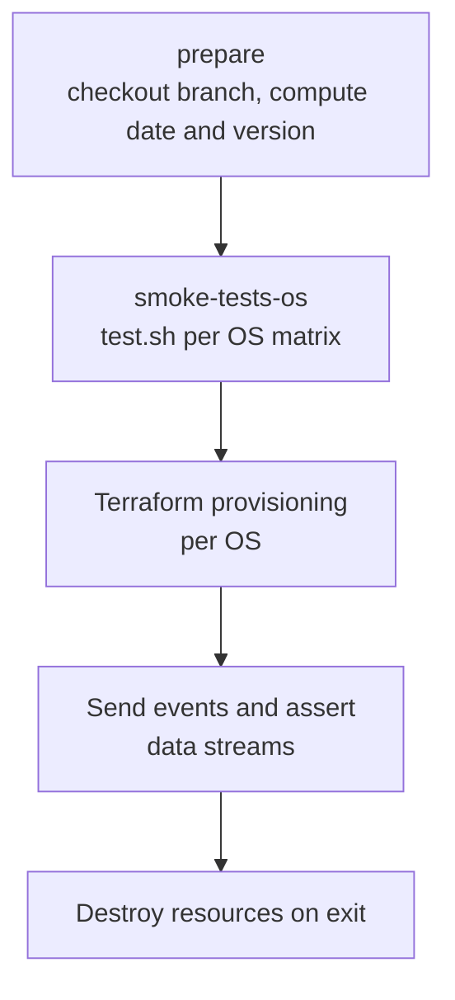

# Smoke Tests OS

Reusable workflow that provisions a Terraform-managed Elastic Cloud deployment and an EC2 host for each supported operating system, installs apm-server, sends events, and checks the resulting data streams.

## At a glance

| Field | Value |
|---|---|
| Definition | [`smoke-tests-os.yml`](../smoke-tests-os.yml) |
| Triggers | Reusable (`workflow_call`) with a required `branch` input; manual (`workflow_dispatch`) with the same input |
| Path filter | None |
| Token permissions | Workflow: `contents: read`. Smoke job: `contents: read`, `id-token: write` |
| Secrets | `EC_API_KEY` (read from Secret Manager, not a repository secret) |
| Runners | `ubuntu-latest` |

## Purpose

Checks that apm-server works on each operating system in the supported OS matrix. It deploys a stack snapshot matching the branch's `major.minor` version, starts apm-server on one EC2 host per OS, and asserts the data streams that receive events.

## When it runs

- **When called** by [`smoke-tests-os-sched.yml`](smoke-tests-os-sched.yml.md) for each active branch.
- **Manually**, with a `branch` input.

## Execution flow

| Job | Runs when | Depends on | What it does |
|---|---|---|---|
| `prepare` | Always | None | Checks out `inputs.branch`. Writes `date` (Unix time in seconds) and `version` (`make get-version`) to job outputs. |
| `smoke-tests-os` | Always | `prepare` | Runs the [`setup-cluster-env`](../setup-cluster-env/action.yml) action, authenticates to AWS and Google Cloud, reads `EC_API_KEY`, then runs `./test.sh <version>` in `testing/smoke/supported-os`. |

### Smoke job steps

| Step | Details |
|---|---|
| Set Terraform | Installs Terraform `~1.10.0` with the wrapper disabled. |
| Setup cluster env | Runs the [`setup-cluster-env`](../setup-cluster-env/action.yml) composite action. It sets up Go from `go.mod` without caching. |
| AWS and Google auth | Uses `elastic/oblt-actions/aws/auth@v1` and `elastic/oblt-actions/google/auth@v1`. |
| Read `EC_API_KEY` | Reads the key from Secret Manager and exports it to the environment. |
| Run smoke tests | Runs [`testing/smoke/supported-os/test.sh`](../../../testing/smoke/supported-os/test.sh) with the version from `prepare`. |

### Test script flow

[`test.sh`](../../../testing/smoke/supported-os/test.sh) sources [`testing/smoke/test_supported_os.sh`](../../../testing/smoke/test_supported_os.sh), which does the following:

1. Generates an SSH key pair named `provisioner_key_<timestamp>`.
2. Loads [`testing/smoke/lib.sh`](../../../testing/smoke/lib.sh) and calls `get_latest_snapshot` to list the snapshot stack versions.
3. Selects the latest snapshot whose version starts with the branch's `major.minor`. The script exits with code 5 if the major version is not 8 or 9.
4. Registers a `terraform_destroy 0` trap on exit, unless `SKIP_DESTROY` is set.
5. For each OS in [`testing/smoke/os_matrix.sh`](../../../testing/smoke/os_matrix.sh), writes a `.tfvars` file with the key name, OS, and stack version. Then it runs `terraform_apply`, `delete_all`, `healthcheck 1`, `send_events`, and `data_stream_assertions` (or the matching assertion function).

The OS matrix in `os_matrix.sh` currently includes Ubuntu 20.04, 22.04, and 24.04 (arm64), Debian 12 (arm64), Amazon Linux 2023, RHEL 8 and 9, Rocky Linux 9, and AlmaLinux 8 and 9. Entries for Rocky 8 and Oracle Linux are commented out.

## Inputs, outputs, and access

| Item | Details |
|---|---|
| Inputs | `branch` (string, required). Used as the checkout ref in `prepare`. |
| Outputs | `date` and `version` (job outputs of `prepare`). Smoke test results in the job log. |
| Environment | `TF_VAR_BUILD_ID`, `TF_VAR_ENVIRONMENT=ci`, `TF_VAR_BRANCH`, `TF_VAR_REPO`, `TF_VAR_CREATED_DATE`, `TF_VAR_ec_target=qa`, `TF_VAR_region=gcp-us-central1`. |
| Permissions | Workflow: `contents: read`. Smoke job adds `id-token: write`. |
| Secrets | `EC_API_KEY` (from Secret Manager). |

## Operational notes

- The version string comes from `make get-version` on the checked-out branch. The Makefile target is defined in the root [`Makefile`](../../../Makefile) at line 183.
- The `SKIP_DESTROY` variable disables the destroy trap in `test.sh`. This is for local debugging.
- The `TF_VAR_region` comment says `gcp-us-central1` is required for QA.
- The `setup-cluster-env` action only installs Go. It does not install Terraform, so the Terraform step in this job is separate.

## Sources

- Workflow: [`smoke-tests-os.yml`](../smoke-tests-os.yml)
- Composite action: [`setup-cluster-env/action.yml`](../setup-cluster-env/action.yml)
- Scripts: [`testing/smoke/supported-os/test.sh`](../../../testing/smoke/supported-os/test.sh), [`testing/smoke/test_supported_os.sh`](../../../testing/smoke/test_supported_os.sh), [`testing/smoke/os_matrix.sh`](../../../testing/smoke/os_matrix.sh)
- Root Makefile: [`Makefile`](../../../Makefile)
- Source gaps: the functions `get_latest_snapshot`, `terraform_apply`, `terraform_destroy`, `delete_all`, `healthcheck`, `send_events`, and `data_stream_assertions` are defined in `testing/smoke/lib.sh`, which was not read in full. The Terraform configuration used by `terraform_apply` was not read. External actions (`elastic/oblt-actions/*`, `google-github-actions/get-secretmanager-secrets`, `hashicorp/setup-terraform`, `actions/checkout`, `actions/setup-go`) are not checked in.
