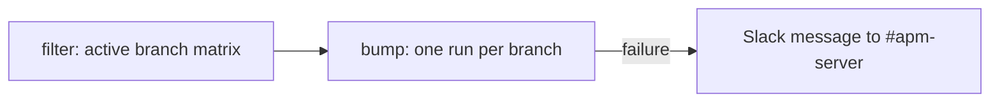

# update-beats

Runs `updatecli` on each active branch to update the `elastic/beats` module version and open a pull request when it changes.

## At a glance

| Item | Value |
|------|-------|
| Platform | GitHub Actions |
| Source | [`update-beats.yml`](../update-beats.yml) |
| Trigger | `workflow_dispatch`; schedule on weekdays |
| Runner | `ubuntu-latest` (`filter` job: `ubuntu-slim`) |

## Purpose

Keeps the Beats module version in sync with `elastic/beats` on every active branch.

## When it runs

- On demand through `workflow_dispatch`.
- On a schedule on weekdays.

## Execution flow

| Job | Runs when | Depends on | What it does |
|-----|-----------|------------|--------------|
| `filter` | Every run | None | Runs `elastic/oblt-actions/elastic/active-branches@v1` with `filter-branches: true` and outputs the branch matrix. Timeout is one minute. |
| `bump` | For each branch in the matrix (`fail-fast: false`) | `filter` | Checks out the branch, creates a GitHub App token, sets up Go from `go.mod`, and runs `updatecli --experimental apply` with `.ci/updatecli/update-beats.yml` and `.ci/updatecli/values.d/scm.yml`, with `BRANCH_NAME` set to the matrix branch. On failure, posts to Slack. |

## Inputs, outputs, and access

| Area | Details |
|------|---------|
| Inputs | None. The branch matrix comes from the active-branches action. |
| Outputs | One pull request per branch when the Beats module changes. Title `[updatecli][<branch>] Update to elastic/beats`, labels `automation` and `backport-skip`, automerge disabled. |
| Permissions | Workflow token `contents: read`. The App token requests `contents: write` and `pull-requests: write`. |
| Secrets | `OBS_AUTOMATION_APP_ID`, `OBS_AUTOMATION_APP_PEM`, `SLACK_BOT_TOKEN` (names only). |

## Operational notes

- The updatecli target runs `.ci/scripts/update-beats.sh <branch>`, which runs `make update-beats BEATS_VERSION=<branch>`. That target runs `go get github.com/elastic/beats/v7@<branch>`, `go mod tidy`, and the `notice` target (see [`Makefile`](../../../Makefile)).
- The script exits successfully without a diff when nothing changed. Otherwise it prints the suggested commit message and the diff.
- Go is installed from `go.mod` because the make target runs `go get` and `go mod tidy`.
- The matrix uses `fail-fast: false`, so one branch failing does not stop the others.
- Source gap: the active-branches, updatecli, and Slack actions are external (`elastic/oblt-actions`). Their behavior is not verified here.
- Source gap: the Beats version resolved from `<branch>` comes from the Go module proxy and is not verified here.

## Sources

- [`.github/workflows/update-beats.yml`](../update-beats.yml)
- [`.ci/updatecli/update-beats.yml`](../../../.ci/updatecli/update-beats.yml)
- [`.ci/scripts/update-beats.sh`](../../../.ci/scripts/update-beats.sh)
- [`.ci/updatecli/values.d/scm.yml`](../../../.ci/updatecli/values.d/scm.yml)
- [`Makefile`](../../../Makefile) (`update-beats`, `update-beats-message` targets)
